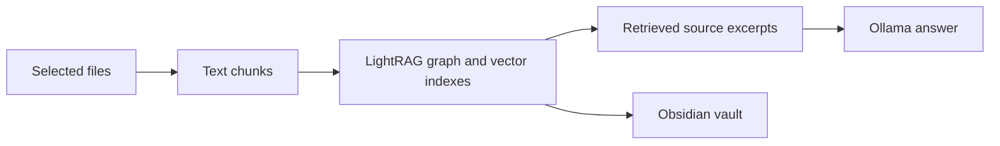

# LocalMind

LocalMind is a desktop app for asking questions about files on your computer.
Choose folders, build a knowledge base, and ask a question. Answers include
source file paths and excerpts so you can check them. You can also explore the
generated knowledge graph in Obsidian.

Ollama runs the chat and embedding models on your machine. The index and vault
are stored locally, and Obsidian is optional for chat.

## Quick start

You’ll need Git, uv, Python 3.11 or newer with Tkinter, and Ollama. The desktop app
has been exercised on macOS. Clean Linux installation is still to be verified.

Run from a source checkout while PyPI distribution is pending:

```bash
git clone https://github.com/Himanshu-370/localMind.git
cd localMind
uv sync
uv run python -c "import tkinter"
```

Start Ollama if it isn’t already running. In a separate terminal, run
`ollama serve` and leave it open.

The default chat model is `qwen3:4b` and the default embedding model is
`nomic-embed-text`. Pull whichever defaults you’re missing:

```bash
ollama pull qwen3:4b
ollama pull nomic-embed-text
```

If you already have `qwen3.5:4b`, you can skip pulling `qwen3:4b`. Run
`uv run localmind paths` to find the config file, then set
`"llm_model": "qwen3.5:4b"`. If the file doesn’t exist yet, create its parent
directory and save this as `config.json` at the reported path:

```json
{
  "llm_model": "qwen3.5:4b"
}
```

Check the setup and launch the app:

```bash
uv run localmind doctor
uv run localmind
```

## Try the demo

1. Click **Add directory** and select `demo_data/projects`. Repeat for
   `demo_data/operations`.
2. Click **Build knowledge base**. The first build can take several minutes.
3. Select **GraphRAG**, enter the question below, and click **Ask**.
4. Read the source excerpts. The demo connects Project Atlas to Kafka on AWS
   MSK, and the incident report links a Kafka connection failure to incorrect
   IAM permissions.
5. To browse the graph, open the vault folder printed by `uv run localmind paths`
   in Obsidian using **Open folder as vault**. Then open **Graph view**. Each
   generated entity note lists relationships and their sources.

> What authentication-related issues could affect Project Atlas?

You can repeat the question with **Vector only**. Try **Who is the CEO of
Project Atlas?** to check that the answer acknowledges the information is
missing from the demo files.

## How retrieval works



LightRAG splits files into chunks and uses Ollama to extract entities and
relationships. **GraphRAG** matches the question to entities and relationships,
then retrieves supporting chunks. **Vector only** searches the chunk embeddings
directly. LocalMind maps the returned chunk IDs back to the original files.
The Obsidian vault is a generated view of the graph and can be browsed separately.

In one demo run on 11 indexed documents, both modes retrieved all expected
source files for the five answerable questions. Both also returned some unrelated
excerpts, and GraphRAG took longer. The recorded benchmark uses the
`ANSWERED` label when chunks are returned, so that label can appear even when
the answer says the information is missing. [Comparison results](results.md)

## Files and refresh

- LocalMind reads Markdown, plain text, selected code and configuration files,
  and PDFs with a text layer. It skips hidden files, symlinks, and common
  credential filenames on a best-effort basis. Review a folder before adding it
  if it contains sensitive files.
- Originals stay in place. Click **Refresh knowledge base** after adding,
  changing, or deleting files. Removing a folder pauses chat until a rebuild
  succeeds.
- Refresh preserves personal notes, edited generated notes, and Obsidian
  settings. A conflicting note stops the refresh with its filename. Rename or
  move the note and retry. If you built your vault with v0.1.0, you can move the
  whole old vault aside before refreshing to keep it and start a fresh graph.
- Use `uv run localmind paths` to locate the config, index, cache, and vault.
  Projects that used checkout-local storage before packaging keep their old
  files in the checkout. The packaged app starts with separate user data.

## Current scope

The first build may download a tokenizer asset. Fully offline build and chat
still need an end-to-end check after setup. Graph extraction depends on the
model and can miss relationships. File watching, a local API, and MCP are part
of the longer-term roadmap. [Engineering spec](SPEC.md)

The repository includes an installer script for the planned published package.
Use the source setup above today. [Installation and onboarding spec](INSTALL_SPEC.md)

## Development

```bash
uv sync --dev
uv run pytest
uv run mypy
uv build
```

After indexing the demo folders, run `uv run python -m localmind.compare` from
the checkout to regenerate the comparison report.
