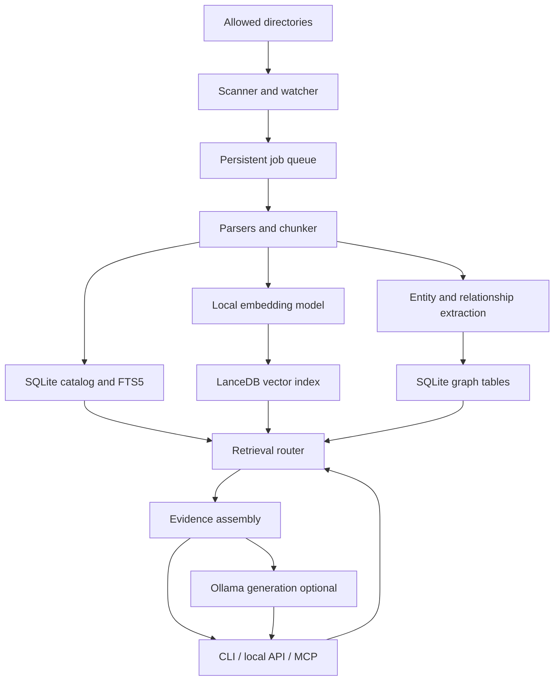

# LocalMind — Engineering Specification

**Version:** 0.1 | **Status:** Proposed | **Target:** macOS first, Linux next

## 1. Product definition
LocalMind is a local-first knowledge engine that indexes explicitly selected directories, builds searchable text and entity relationships, and exposes evidence-backed retrieval through a CLI, local chat and MCP. All core inference and storage run locally. No account, cloud service or paid API is required. Hardware, electricity and storage are not free.

### Goals
- Discover files by meaning, exact terms, metadata and relationships.
- Answer cross-document and cross-repository questions with verifiable citations.
- Keep indexes synchronized with filesystem changes.
- Make retrieval available independently of answer generation.
- Run on a 16 GB laptop with bounded resource usage.

### Non-goals (v1)
Whole-disk surveillance, arbitrary command execution, autonomous file editing, cloud synchronization, multi-user access, OCR, email ingestion, fine-tuning, and exhaustive understanding of every file format. Do not promise answers about unindexed or inaccessible data.

### Example
A user indexes ~/Projects and ~/Notes. A README states that Cloudwire uses AWS; a dependency manifest identifies Python; a note describes AWS event-driven architecture. The question “Which Python projects use AWS and what notes might help?” retrieves project relationships, follows evidence links, searches relevant notes and returns an answer with file paths and line ranges. These are illustrative data, not inspected files.

## 2. Architecture



### Technology decisions
| Layer | Default | Rationale |
|---|---|---|
| Runtime | Python 3.11+ | Rapid implementation and parser ecosystem |
| CLI | Typer | Small, scriptable interface |
| Catalog / queue / graph | SQLite WAL + FTS5 | Embedded persistence, transactions, no daemon |
| Vector index | LanceDB | Embedded vector retrieval |
| Graph traversal | SQL recursive CTE or bounded Python traversal | Avoid separate graph server initially |
| Inference | Ollama HTTP API | Local model lifecycle and generation |
| Models | Configurable small Qwen-family instruct model; nomic-embed-text candidate | Quantized local inference; benchmark before pinning |
| Parsing | stdlib, pypdf, python-docx, tree-sitter later | Format-specific extraction |
| Watcher | watchdog | Cross-platform events |
| API | FastAPI | Typed local endpoints |
| MCP | Python MCP SDK, stdio | Agent interoperability |
| UI | React + local API; Tauri optional later | Defer desktop packaging |
| Testing | pytest | Unit, integration and regression suites |

Model availability, redistribution licenses, embedding dimensions and performance must be verified when dependencies are pinned. NetworkX may be used for prototyping or visualization, not as the authoritative persistent graph.

## 3. Data contracts
Use UUIDs or deterministic hashes as appropriate. All records carry schema version where necessary. Paths are normalized, root-relative and resolved only against allowed roots.

| Record | Required fields |
|---|---|
| Root | root_id, canonical_path, enabled, exclusions, created_at |
| File | file_id, root_id, relative_path, content_hash, size, mtime_ns, status, active_revision |
| Revision | revision_id, file_id, hash, parser_version, created_at |
| Chunk | chunk_id, revision_id, ordinal, text, page or line range, token_count |
| Vector | chunk_id, revision_id, model_id, dimensions, embedding |
| Entity | entity_id, type, canonical_name, normalized_key |
| Mention | entity_id, chunk_id, span, extraction_method |
| Edge | edge_id, source_entity, predicate, target_entity, confidence, extractor_version |
| Evidence | edge_id, chunk_id, source_span, extraction_method |
| Job | job_id, file_id, desired_hash, stage, attempts, lease_until, error |

Entity types: Project, File, Technology, Symbol, Concept, Organization (optional). Initial predicates: CONTAINS, IMPORTS, DEPENDS_ON, USES, DEFINES, MENTIONS, RELATED_TO. Distinguish observed facts from inferred relations. RELATED_TO must not be treated as proof of USES. Multiple sources may support one edge; deleting one source must not remove other valid evidence.

### Consistency protocol
SQLite is authoritative. Stage chunks and vectors under a new revision; activate the revision in SQLite only after required writes succeed. Retrieval filters against active revisions and allowed roots, including after vector search. Oversample or retry vector candidates if stale entries are filtered. Clean old vectors asynchronously. A crash before activation leaves the old revision available; recovery removes or resumes staged data. Deletion tombstones the file immediately, invalidates evidence, and queues physical cleanup. No distributed transaction is assumed.

## 4. Phase 0 — Foundations (2–3 days)
**Deliverable:** runnable repository and reproducible local environment.
- Establish package layout, config validation, migrations, structured logging and CI.
- Implement `localmind init`, `doctor`, `version`, `config show`.
- Check Ollama connectivity, available models, writable storage, disk space and FTS5 support. Do not automatically download models without consent.
- Configure root allowlist, maximum file size (default 20 MB), ignore patterns, worker concurrency (default 1), storage location and model identifiers.
- Establish fixtures: 30–50 synthetic documents and two small repositories, including duplicates, malformed files and secret-like files.
**Exit:** fresh install works; missing Ollama yields actionable errors; unit tests run without model downloads; no telemetry or network calls except explicitly configured local endpoints.

## 5. Phase 1 — Local search MVP (week 1)
**Deliverable:** searchable local filesystem catalog without graph or LLM generation.
- Commands: `root add`, `root list`, `root remove`, `index`, `status`, `search`.
- Walk allowed roots; skip hidden directories by default, symlinks, binaries, .git, node_modules, virtual environments, build outputs, .env and private keys. Honor configurable ignore rules and optionally .gitignore.
- Detect MIME/type, enforce size limits, hash content with SHA-256, and track path plus revision.
- Parse TXT, Markdown, PDF (text layer), DOCX, JSON and selected code files. Preserve page numbers or line ranges; mark scanned PDFs unsupported rather than hallucinating text.
- Chunk by headings/paragraphs or code boundaries where possible; starting target 400–600 tokens, overlap 60–100; configurable and measured against retrieval tests.
- Persist chunks and FTS5 index; return ranked snippets, path, location and revision.
- Continue after individual parse failures; expose skipped/error counts.
**Exit:** exact terms and filenames retrievable; duplicate content avoids unnecessary parsing while preserving distinct file identities; exclusions verified; repeated indexing is idempotent; unsupported files do not crash indexing.

## 6. Phase 2 — Semantic RAG (week 2)
**Deliverable:** local question answering with citations.
- Implement embedding provider abstraction, batching, caching by chunk hash and model identity, vector writes and similarity search.
- Add hybrid lexical/vector retrieval using reciprocal rank fusion (initial k=60). Initial candidate pools 30 per retriever, final context 6–12 chunks, configurable.
- Add `ask` and `search --mode keyword|vector|hybrid`; search remains available if generation is unavailable.
- Assemble evidence within model context budget; deduplicate overlapping chunks and diversify sources.
- Prompt model to treat file contents as untrusted data, answer only from evidence, cite source IDs, and abstain when evidence is insufficient. Validate cited IDs against supplied evidence; this does not guarantee factual correctness.
- Return answer, citations, retrieval mode, model identity, elapsed time and warnings. Support streaming optionally.
- On embedding model change, build a new index generation; never mix incompatible dimensions or model versions.
**Exit:** golden questions demonstrate semantic paraphrase retrieval; every emitted citation resolves to an active source; unsupported questions can abstain; no paid API calls; benchmark keyword vs vector vs hybrid.

## 7. Phase 3 — Knowledge graph (weeks 3–4)
**Deliverable:** evidence-backed multi-hop retrieval.
- Start with deterministic extraction: repository boundaries, manifests, imports, Markdown links, headings and file containment. Use tree-sitter for supported languages when needed.
- Add optional local LLM extraction for prose. Require structured JSON with entity types, predicates and exact supporting spans; reject invalid schemas, unsupported predicates and unverifiable spans.
- Normalize aliases conservatively (e.g. PostgreSQL/Postgres); do not merge unrelated projects or ambiguous symbols automatically. Namespace code symbols by repository and qualified name.
- Persist entities, mentions, edges and evidence. Deduplicate edges while retaining all provenance. Confidence is a heuristic, not a calibrated probability.
- Resolve query seeds via lexical/entity matching and vector candidates. Traverse at most two hops by default, cap fan-out and total visited nodes, and rank paths by evidence, relevance and confidence.
- Merge graph-derived chunks with lexical/vector results. Use graph mode for relationship queries; retain direct search for filenames and simple facts. Start with explicit mode selection and deterministic routing, not an LLM router.
- Add `graph neighbors`, `graph path`, `graph stats`, `search --mode graph`, and `ask --mode hybrid-graph`.
**Exit:** multi-hop questions return correct supporting paths; graph edges always have provenance; deleting evidence invalidates unsupported edges; compare against non-graph baseline and keep graph optional if it does not improve results.

## 8. Phase 4 — Continuous indexing (week 5)
**Deliverable:** persistent, self-maintaining index.
- Watch create/modify/delete/move events; debounce bursts (initial 1 second), coalesce jobs by file and desired revision.
- Use SQLite-backed job queue with leases, bounded retries, exponential backoff and dead-letter state. Check current hash before committing stale work.
- Handle rename, atomic editor saves, watcher overflow, root removal and sleep/resume. Periodic reconciliation detects missed events; default interval 15 minutes.
- Update only changed files; reuse cached embeddings; invalidate graph evidence by revision. Keep old revision active during updates, except deletion or permission revocation.
- Implement `watch`, `pause`, `resume`, `reconcile`, `jobs`, `retry`, `purge`. Report pending work and freshness; never silently imply a stale index is current.
- Prioritize interactive retrieval over background extraction; cap concurrency, queue size and memory; allow graph extraction to be deferred.
**Exit:** create/edit/delete/rename integration tests pass; restart recovers unfinished jobs; unchanged files trigger no inference; deletion immediately removes search visibility; watcher failures recover through reconciliation.

## 9. Phase 5 — API and MCP (week 6)
**Deliverable:** reusable local knowledge service.
- FastAPI binds to 127.0.0.1 only by default. Require a local token for HTTP access; restrict CORS; no remote binding without explicit configuration.
- MCP stdio transport exposes read-only tools by default. Use explicit client configuration and root-level access policy. No arbitrary shell, filesystem writes or unrestricted path reads.
- MCP tools: `search_knowledge(query, mode, limit, root_ids)`, `get_source(chunk_id)`, `get_entity(entity_id)`, `get_neighbors(entity_id, depth, limit)`, `find_relationship(source_id, target_id)`, `index_status()`.
- HTTP endpoints: GET /v1/health, GET /v1/status, POST /v1/search, POST /v1/ask, GET /v1/sources/{chunk_id}, GET /v1/entities/{entity_id}/neighbors. Separate privileged index-management operations from retrieval.
- Validate limits, identifiers and authorization on every call. Return structured evidence, not only generated text. External agents may transmit retrieved data to cloud providers; warn users explicitly.

Example search request:
```json
{"query":"Which projects use AWS?","mode":"hybrid-graph","limit":8,"root_ids":["projects"]}
```
Example result shape:
```json
{"results":[{"chunk_id":"c1","path":"Cloudwire/README.md","lines":[12,18],"snippet":"Uses AWS APIs...","score":0.82,"relations":[{"predicate":"USES","target":"AWS"}]}],"warnings":[]}
```
Scores are ranking signals, not factual probabilities. IDs and content are illustrative.
**Exit:** an MCP client can discover and invoke tools; retrieval works without generation; unauthorized roots and path traversal are rejected; no network listener is exposed by default beyond loopback.

## 10. Phase 6 — Local UI and distribution (weeks 7–8)
**Deliverable:** usable open-source release.
- Local UI: root selection, indexing status, search, chat, source preview, bounded graph explorer, model settings, pause and purge controls.
- Show citations and source locations; mark stale or unavailable sources. Graph explorer expands neighbors on demand instead of rendering the entire graph.
- Package CLI via pipx/uv; provide macOS setup instructions and Linux smoke tests. Desktop wrapper is optional after CLI/API stability.
- Document data directory, model download size, license obligations, threat model, benchmarks, uninstall and deletion instructions.
- Publish synthetic demo dataset, architecture diagram, contributing guide and reproducible evaluation commands.
**Exit:** new user can index sample data and ask a question without editing source code; all release tests pass; license review completed; no mandatory paid dependency.

## 11. Evaluation and performance
Build evaluation from Phase 0, not after release. Use a versioned golden dataset with query, expected evidence IDs, expected answer facts, allowed roots and query category. Include exact lookup, paraphrase, cross-file, multi-hop, negative and stale-source cases. Split tuning and held-out sets. Begin with 50 queries and expand to 100+.

| Metric | Proposed initial target |
|---|---|
| Recall@10 | >= 0.85 on held-out evidence retrieval |
| Citation validity | 100% resolve to authorized active sources |
| Answer factual support | >= 90% of sampled claims supported by cited evidence |
| Graph edge precision | >= 90% on manually reviewed sample |
| Graph contribution | Improve multi-hop recall over hybrid baseline without material simple-query regression |
| Search p95 | <= 2 seconds warm, excluding generation, on reference corpus |
| First token p95 | <= 10 seconds warm, provisional |
| Freshness | <= 60 seconds for ordinary small-file lexical updates under light load; semantic/graph lag reported separately |
| Memory | Target <= 10 GB combined engine and model RSS under reference workload; measure system pressure too |

Reference benchmark: 16 GB Apple Silicon Mac, 1,000 supported files, approximately 10,000 chunks, one background worker, small quantized model. Record exact hardware, model, corpus size, cold/warm runs, indexing throughput, disk usage, p50/p95 and failure rate. These are acceptance hypotheses, not measured results. Use deterministic tests and manual evidence review; optional local LLM judges are secondary. Track graph vs vector vs hybrid ablations. Do not ship misleading quality claims.

## 12. Security and privacy
- Explicit root consent; no full-home scan by default. Resolve paths and reject escapes, symlinks and disallowed file types. Recheck authorization on retrieval and source opening.
- Exclude credentials and secret-like files; exclusions cannot guarantee detection of every secret. Provide preview and purge controls.
- Treat documents as untrusted input. Never execute document instructions, macros, embedded scripts or commands. Bound parser time, file size and archive expansion; isolate parsers where practical.
- Keep logs free of raw content by default. Restrict index directory permissions to the current user. Rely on OS disk encryption if enabled; do not claim application-level encryption.
- Removing a root immediately revokes retrieval access and schedules physical cleanup. Explain that backups, SQLite WAL and storage behavior can prevent guaranteed forensic erasure.
- Default to local inference endpoint; warn before configuring remote endpoints or connecting cloud agents. No telemetry by default.

## 13. Repository layout
```text
localmind/
  pyproject.toml
  SPEC.md
  README.md
  src/localmind/
    cli.py
    config.py
    catalog/
    ingestion/
    parsers/
    embeddings/
    graph/
    retrieval/
    generation/
    scheduler/
    api/
    mcp/
    security/
  tests/unit/
  tests/integration/
  evals/fixtures/
  evals/golden/
  benchmarks/
  ui/
  docs/
```
Keep provider interfaces small: Parser.parse(file) -> blocks; Embedder.embed(texts) -> vectors; Extractor.extract(chunk) -> entities/edges/evidence; Retriever.search(query, scope, limit) -> hits; Generator.answer(query, evidence) -> answer. Catalog owns revision visibility. Avoid microservices, Kubernetes and external database servers for v1.

## 14. Failure handling
| Failure | Expected behavior |
|---|---|
| Ollama unavailable | Keyword search works; semantic indexing waits; ask returns actionable error |
| Invalid extraction JSON | Bounded retry, record failure, keep lexical/vector data |
| Disk full | Stop new writes, preserve active revisions, surface error |
| File changes during parse | Discard stale work and enqueue latest revision |
| Vector index corruption | Rebuild from active chunks; lexical search remains available |
| Permission revoked | Hide affected sources, invalidate on reconciliation |
| No relevant evidence | Abstain or return search results; no invented sources |

## 15. Release priorities and decisions
P0: phases 0–2, security, citations, baseline evaluation. P1: graph and incremental updates. P2: MCP and packaging. P3: UI polish, additional parsers, graph visualization. First public alpha can ship after Phase 2; differentiated beta after Phase 5. Estimated eight weeks assumes focused solo development and is not a commitment; part-time work may take longer.

Proposed code license: Apache-2.0, subject to dependency and model license review. Keep model downloads separate from distribution. No monetization requirement. Potential future extensions: local multimodal search, OCR, encrypted index, opt-in connectors, graph communities and local agent memory. Defer until core retrieval is reliable.

### Open decisions
- Exact model and quantization: benchmark on target laptop.
- Graph extraction budget and default enabled state: decide from ablation results.
- Whether graph storage needs a dedicated engine: revisit only after profiling.
- Product name availability and final license: verify before public launch.
- UI packaging and cross-platform support: decide after CLI adoption.

### Definition of done for v1
A user can install locally, select directories, index supported files, retrieve by keyword/meaning/relationships, receive evidence-backed answers, edit or delete files and observe index updates, and connect an MCP client with explicit access controls. All core operations work offline after dependencies and models are installed. The project publishes reproducible quality/performance results and documents limitations.

---

## 16. Minimal showcase MVP — local GraphRAG with Obsidian

### 16.1 Objective and scope

Demonstrate that a user can select local directories, automatically construct a knowledge graph from their contents, explore that graph in Obsidian, and ask multi-document questions answered by a local model with original-file citations. No paid APIs, cloud services, custom web frontend, or standalone database servers. This section supersedes earlier architectural choices **for the showcase MVP only**; sections 1–15 remain the long-term roadmap, not MVP requirements.

### 16.2 Stack

| Component | Responsibility |
|---|---|
| Python 3.11+ | Integration, ingestion, configuration, export |
| Tkinter | Native desktop window, folder picker, progress, chat |
| LightRAG | Entity and relationship extraction orchestration, embedded graph/vector storage, retrieval |
| Ollama `qwen3:4b` | Local extraction and answer generation |
| Ollama `nomic-embed-text` | Local embeddings |
| Obsidian | Browse generated Markdown notes and native graph view |

Use LightRAG's local default storage adapters; do not introduce SQLite, LanceDB, Neo4j, React, Streamlit, FastAPI or Docker as separate MVP components. Pin tested dependencies and verify the installed LightRAG API and storage adapters before implementation. Obsidian is proprietary but free for local use; it is optional for querying and required for the graph showcase. Hardware, electricity and optional services are excluded from the zero-cost claim.

### 16.3 User journey and interface

Launch with `python app.py`. A single Tkinter window contains a source panel, status/progress panel and chat panel.

1. On launch, check Ollama at `http://127.0.0.1:11434`, required models, and writable storage. Show actionable errors without blocking directory selection.
2. Click **Add directory** to open `tkinter.filedialog.askdirectory()` on the GUI main thread. Repeat to select multiple directories. Cancellation changes nothing. Show absolute paths and allow removal. Persist selections in `config.json`.
3. Click **Build knowledge base**. Recursively discover supported files in selected roots only. Display discovered, processed, skipped and failed counts, and current stage. Keep the GUI responsive using a background worker and a thread-safe queue polled with `after()`; no Tkinter calls from workers.
4. When indexing completes, export the graph as a dedicated Obsidian vault. Click **Open in Obsidian** to open the vault if registered; otherwise display its path and instructions to open it as a folder vault. Never modify an existing personal vault by default.
5. Enter a question in the chat panel and click **Ask**. Select `GraphRAG` (default) or `Vector only` for comparison. Display answer, source paths and supporting excerpts. Show loading and errors without freezing the UI.
6. Add/remove directories or click **Refresh knowledge base** to manually rebuild. Mark the index stale after source changes; disable querying stale data after removal until rebuild succeeds. Persist the last successful index across restarts.

### 16.4 Architecture and data flow

```text
Tkinter directory picker -> Python scanner/parser -> LightRAG
                                                     |  ^
                                                     v  |
                                              Ollama local models
                                                     |
                                  local graph + vector + document storage
                                      |                         |
                              Markdown exporter           retrieval + LLM
                                      |                         |
                              Obsidian vault               Tkinter chat
```

LightRAG is the authoritative graph and retrieval engine. Obsidian is a read-only-in-practice visualization projection, not a second retrieval engine. User edits to generated notes are not ingested. Exclude the vault and storage from scanning to prevent recursive ingestion.

### 16.5 Phase-wise implementation

**M0 — Setup and smoke test (1–2 hours).** Install dependencies, verify Tkinter with `python -m tkinter`, run `ollama pull qwen3:4b` and `ollama pull nomic-embed-text`. Configure local generation and embedding adapters. Verify one generation and embedding call; use the actual embedding dimension returned by the model (normally 768 for Nomic). Start with one indexing worker, modest context, low temperature and non-thinking mode where supported. Confirm all inference endpoints are loopback and disable remote fallbacks.

**M1 — Directory selection and ingestion (2–3 hours).** Implement Tkinter source list, native picker, remove and build buttons. Canonicalize and deduplicate roots; skip symlinks and files outside approved roots. Support UTF-8 Markdown and TXT first, then text-based PDF using pypdf if time permits. Source code can be added as plain text. Skip binary, oversized, hidden and credential files, `.git`, `node_modules`, virtual environments, `.env*`, private keys and generated output. Report skips and parse failures. Preserve original paths and chunk provenance. Never modify source files.

**M2 — GraphRAG and local chat (3–4 hours).** Initialize LightRAG with local storage and Ollama adapters. Insert document text with stable document IDs and source metadata. Verify entities and relationships are generated. Use the installed version's supported graph-aware mode (e.g. hybrid or mix) and naive/vector mode for comparison. Obtain retrieved evidence through the supported retrieval/context API; map evidence IDs to original paths and excerpts. Do not invent citations or rely solely on model-generated filenames. If evidence is insufficient, say so. Implement chat and progress with background workers; serialize indexing and querying initially.

**M3 — Obsidian export (2–3 hours).** Read graph nodes and edges through the supported LightRAG interface or a version-pinned export adapter. Generate one Markdown note per entity with stable sanitized filenames, description, relationship labels, wiki links (`[[Entity]]`), and original source references. Resolve name collisions deterministically. Export into a dedicated generated vault; regenerate only owned output. Obsidian graph view renders links, while edge semantics remain visible in note text. Validate no broken internal links. Open the vault manually or via an appropriate Obsidian URI when supported.

**M4 — Refresh, demo and validation (2–3 hours).** Implement manual full rebuild in staging storage; publish the index and vault only on success, retain previous artifacts on failure, and prevent removed-source data from being queried. Store configuration and an index manifest with source paths, counts and model settings. Test offline operation, directory removal, error states and multi-hop retrieval. Write a concise README with installation, model downloads and launch steps.

Estimated effort: 10–15 focused hours, excluding model download and indexing time. This is provisional; local model extraction quality and LightRAG integration may require additional work.

### 16.6 Minimal repository layout

```text
localmind/
  app.py              # Tkinter UI and worker coordination
  ingest.py           # discovery, parsing, provenance
  rag.py              # LightRAG and Ollama adapters
  export_graph.py     # Obsidian Markdown projection
  config.json         # selected roots and settings (local, gitignored)
  requirements.txt
  README.md
  demo_data/          # synthetic test documents
  storage/            # generated index, gitignored
  vault/              # generated Obsidian vault, gitignored
```

### 16.7 Demonstration dataset and script

Create four Markdown files in two separate directories:

| File | Content |
|---|---|
| projects/project.md | Project Atlas uses Kafka. |
| projects/architecture.md | Atlas Kafka is hosted on AWS MSK. |
| operations/security.md | AWS MSK requires IAM authentication. |
| operations/incidents.md | Incorrect IAM permissions caused a Kafka connection failure on AWS MSK. |

Add 6–10 unrelated synthetic documents to test retrieval discrimination. Do not use confidential workplace files in the demo.

Five-minute presentation (pre-index a backup dataset if local extraction is slow):

1. Launch the app, select both directories through the native folder picker, and build the knowledge base.
2. Open Obsidian and explore Atlas → Kafka → AWS MSK → IAM permissions → connection failure. Open a generated note to show evidence and relationships.
3. Ask: “What authentication-related issues could affect Project Atlas?” Expect a qualified answer connecting the project to IAM-related Kafka failures, with original file references.
4. Repeat using vector-only mode and compare retrieved evidence and answer completeness. Keep model, corpus and comparable retrieval budgets fixed. Do not claim GraphRAG is superior unless measured results support it.
5. Disconnect internet (after downloading dependencies/models) and repeat a query to demonstrate local operation.

### 16.8 Acceptance criteria

- [ ] Native folder picker supports multiple roots, cancellation, removal and persistence.
- [ ] Index 10–20 small supported local documents without changing originals.
- [ ] UI remains responsive and reports indexing progress and failures.
- [ ] LightRAG constructs persistent graph and vector indexes using only local Ollama models.
- [ ] Obsidian vault contains generated entity notes, working wiki links, relationship descriptions and source references.
- [ ] Chat answers a multi-document question with verifiable original-file citations and excerpts.
- [ ] Vector-only and graph-aware retrieval modes are demonstrable; record evidence recall, answer correctness and latency for at least five questions, including an unanswerable question.
- [ ] Manual refresh reflects additions, modifications and removals; removed sources are no longer retrievable after rebuild.
- [ ] App works offline after installation, without paid APIs or remote fallback.
- [ ] Missing Ollama, model errors, unsupported files and failed rebuilds produce actionable messages.

### 16.9 Explicit non-goals and definition of done

No MCP, background file watcher, incremental graph synchronization, custom graph UI, web server, desktop installer, authentication, cloud sync, whole-disk scanning, OCR, or arbitrary filesystem actions. No requirement to outperform vector retrieval on every question. No custom Obsidian plugin.

The MVP is done when a user can launch the app, select directories, build a local knowledge graph, open it in Obsidian, and ask grounded questions from the same desktop app. Deliver source code, pinned dependencies, README, synthetic demo data and recorded comparison results. Validate model licenses before redistribution; do not bundle proprietary Obsidian binaries.
